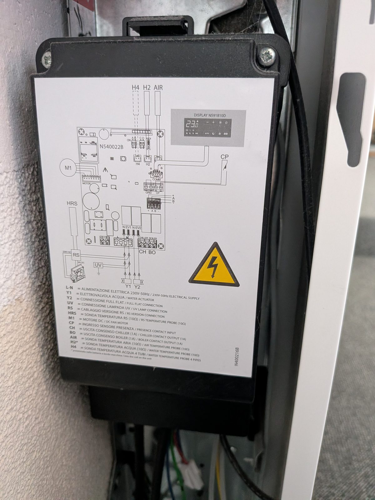
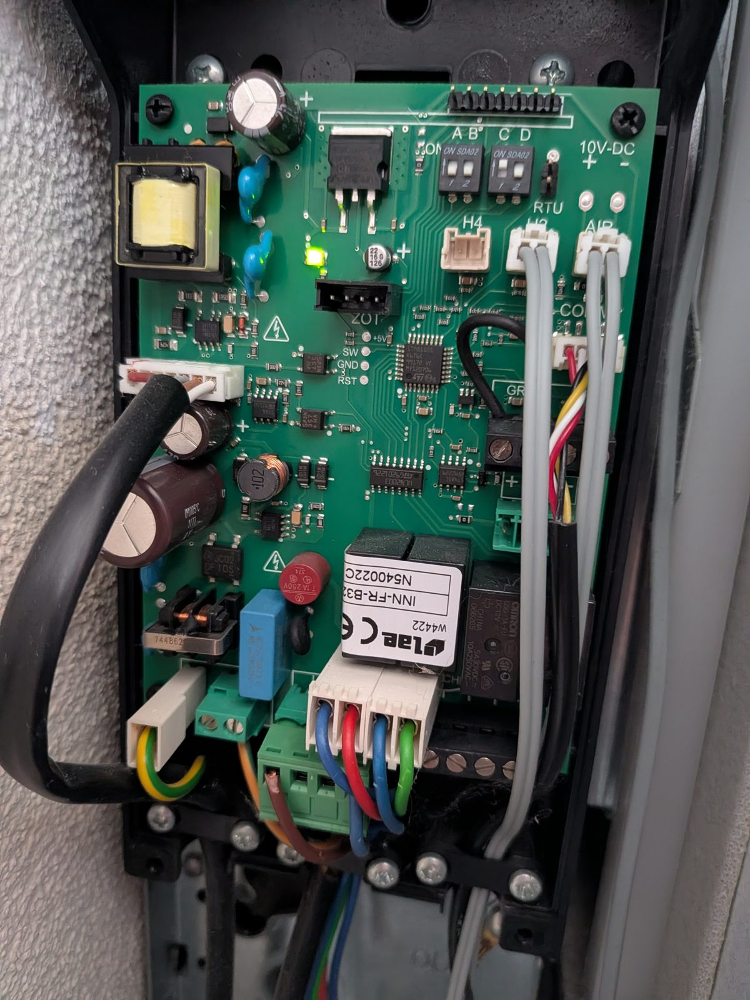
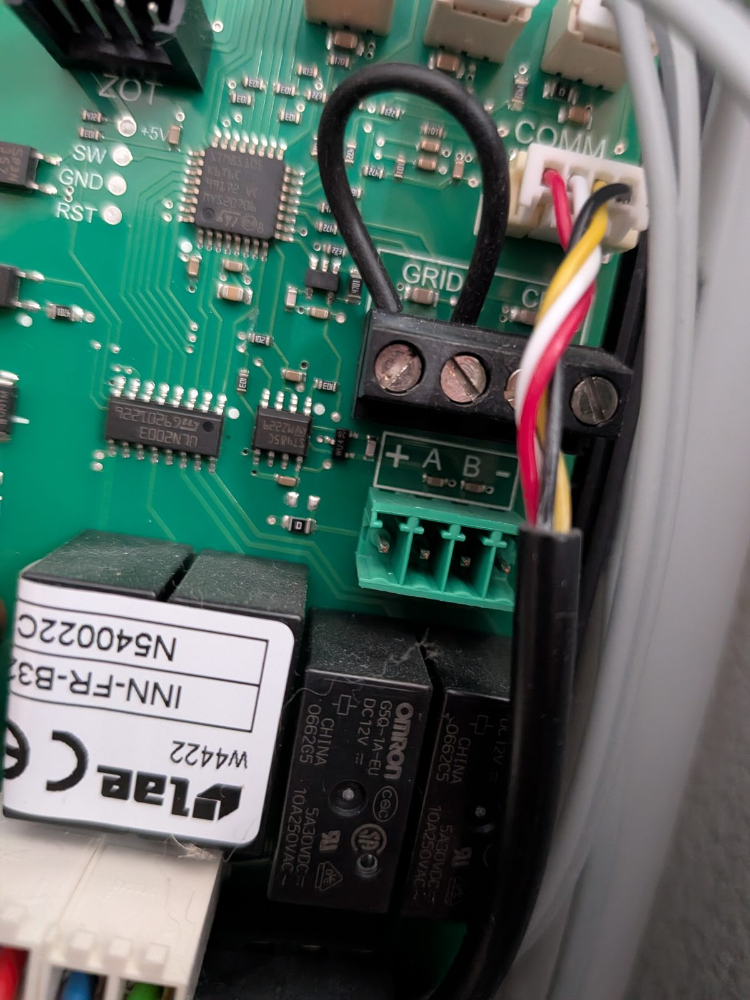
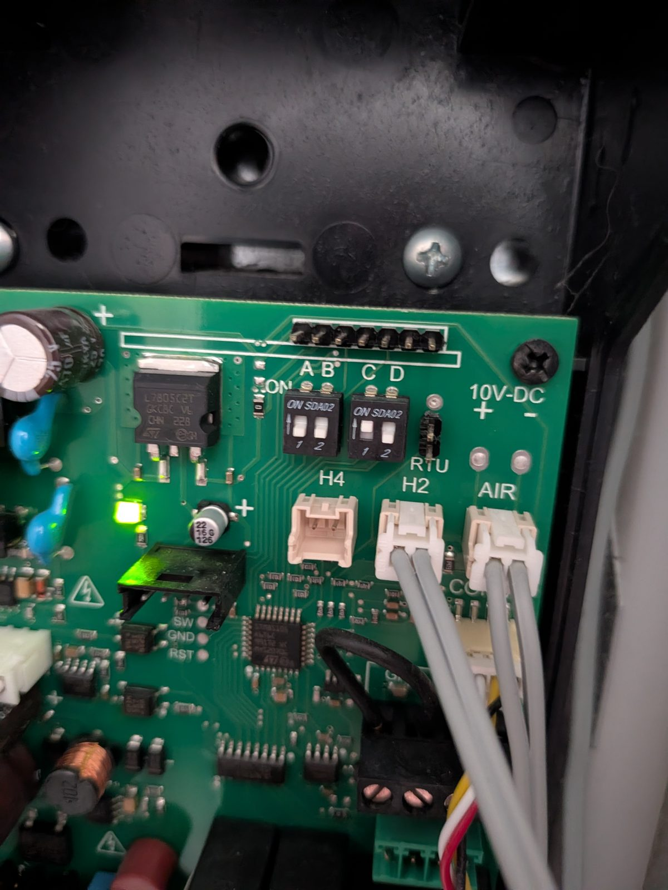

# innova-fancoil

ESPHome firmware for reading, and carefully writing, an **Innova AirLeaf SL** fancoil (tested on
an SL600, control board N540022C) over its RS485 port with a
[LilyGo T-CAN485](https://github.com/Xinyuan-LilyGO/T-CAN485) ESP32 board, plus a **Modbus
discovery tool** for devices with an unknown register map.

Innova does not publish the Modbus register map for this board. Everything below was found by
probing and is **unofficial and incomplete**.

**Status:** the fancoil answers Modbus RTU (settings below).

- **Mapped and published to Home Assistant:** room temperature, water temperature, setpoint, fan
  mode, on/off, operating mode and the water cut-off thresholds.
- **Confirmed writable** (FC06, tested with the panel): setpoint (reg 231), fan mode and on/off
  (reg 201), and the heating minimum water temperature (reg 218; kept over a power cycle, its effect
  on the fan is not tested yet).
- **Writes** go only through a guarded write test (switch plus allowlist); there are no regular
  Home Assistant controls yet.
- The rest of the configuration parameters (196–277) are not mapped yet.

> Not affiliated with or endorsed by Innova. The fancoil has mains voltage inside: switch it off at
> the breaker before opening it. Use at your own risk.

## Findings

### Connection

| | |
|---|---|
| Port | 4-pin green terminal **"+ A B −"** on the control board (unused from the factory) |
| Mode, jumper on **RTU** | **Modbus RTU, 9600 baud, 8N1** (recommended; ESPHome `modbus_controller` speaks RTU) |
| Mode, jumper on **ASCII** (factory) | **Modbus ASCII, 9600 baud, 7E1** |
| Slave address | **1** |
| Functions | 03 and 04 both answer, with identical values |
| Polarity | The fancoil's **B** idles high (+2.3 V to −), **A** low (+0.9 V). Innova uses the "B = D+" convention, so wire fancoil **B → transceiver A** and fancoil **A → transceiver B** for a Maxim-style transceiver like the one on the T-CAN485 |
| GND | Fancoil **−** to the LilyGo's GND |
| + | Supply voltage, not measured yet; not connected (the LilyGo runs on USB-C) |

The board's **ASCII / RTU jumper** (3-pin, next to the DIP switches) selects the Modbus framing. It
comes in the **ASCII** position, where the board ignores all RTU frames, so an RTU-only scan finds
nothing. Moving the cap to the two pins on the "RTU" side (fancoil switched off at the breaker)
gives Modbus RTU at 9600 8N1, which ESPHome's `modbus_controller` speaks. Register values are the
same in both modes. The transceiver on the fancoil board is an ST485.



| Board | RS485 terminal | ASCII/RTU jumper and DIP switches |
|---|---|---|
|  |  |  |

DIP switches as found: A off, B off, C on, D off (meaning unknown, see the installation manual's
"Set-Up of Auxiliary Dip-Switch Functions"). The 4-pin **ZOT** header next to the pads `+5V SW GND
RST` is the STM8 programming (SWIM) port, not a bus.

### Registers

- **One register table.** FC03 and FC04 return the same 146 registers with the same values, over
  ASCII and RTU. FC01/02 (coils, discrete inputs) return exception 1, illegal function.
- **146 registers answer** in 0–1999: 0–19, 21–22, 101–111, 196–215, 218–236, 238–250, 255–277,
  600–603, 700–702, 704–705, 707, 800–802, 807–808, 998–999, 1050–1059, 1061, 1100–1107, 1150–1151.
  The rest return exception 2, illegal data address.
- **Read one register per request.** Multi-register reads are refused at times with exception 3,
  illegal data value, even for ranges that answered as a block before.
- Values are signed 16-bit; temperatures are ×0.1 °C.

**Confirmed** with panel changes (2026-10-13):

| Reg | Meaning | Values |
|---:|---|---|
| 0 | room temperature | ×0.1 °C (panel showed 19.9 °C, register 199) |
| 8 | setpoint, read-only (FC06 refused: illegal data address) | ×0.1 °C (180 = 18.0 °C) |
| 18 | room temperature, follows reg 0 a few seconds later (filtered?) | ×0.1 °C |
| 1 | water temperature (coil probe) | ×0.1 °C; stayed 20.4 while the heat pump heated the DHW tank (3-way valve to the tank), read 44.3 minutes after the valve switched back, follows the heat pump supply (21.9 vs 21.8) when idle |
| 5, 6 | room and water temperature in 0.05 °C steps | reg 5 = 2 × reg 0, reg 6 = 2 × reg 1 (e.g. 204 → 408, 443 → 887) |
| 10, 11, 12 | raw ADC of the air and water probe; reg 12 = 8238 is the full-scale value | |
| 13, 14 | air and water probe as 10-bit ADC (0–1023), = reg 10/11 × 1023 / reg 12 | NTC: goes down as the temperature goes up (water 20.4 °C → 414, 44.3 °C → 225) |
| 231 | setpoint, **writable** with FC06: the panel shows the new value at once, reg 8 follows | ×0.1 °C (tested 180 → 185 → 180) |
| 201 | fan mode and on/off, bit field, **writable** with FC06 (panel follows at once) | bits 0–1: 0 auto, 1 min, 2 night, 3 max; bit 7: 1 = off (tested 0 → 1 → 0 → 128 → 0) |
| 700, 701, 707 | bits 0, 1 and 7 of reg 201 as separate 0/1 registers | |
| 233 | operating mode | 3 heating, 5 cooling |
| 104 | status bit field | 0x0010 on, 0x0800 off; bits 0 and 9 also set in cooling (with warm water) |
| 9, 21, 105 | status, only non-zero in cooling (with warm water); reg 9 counted 1 → 5 → 0 | |

Note: Innova's WiFi API numbers the fan function 1–4 (auto, night, min, max); Modbus reg 201 uses
0–3 in a different order.

**Guesses** (not confirmed):

| Reg | Value at test | Guess |
|---:|---:|---|
| 218, 219 | 300, 200 | fan cut-off water temperatures, ×0.1 °C: 218 = heating minimum (30.0 °C, the factory default), 219 = cooling maximum (20.0 °C). 218 is **writable** with FC06 and kept over a power cycle (EEPROM): set to 250 on 2026-10-13. Not yet seen to change when the fan starts |
| 2, 7, 16 | −510, −1020, 1023 | missing probe (H4, the 4-pipe water probe, is not fitted): 16 is its 10-bit ADC at full scale (open circuit), like 13/14 for the fitted probes |
| 3, 4 | 9–13, 11 | ? (reg 3 changes slowly) |
| 196–277 | see dump | configuration parameters: 202/203 = 160/280 (setpoint limits 16–28 °C?), 210–215 = 400…1700 (fan speeds in rpm?), several water-temperature thresholds of 20–50 °C (218 = 30.0, 219 = 20.0, 260 = 45.0, …) |

<details>
<summary>Full FC03 dump of all 146 registers (register, signed value, hex), heating, fan on min, setpoint 18.5 °C</summary>

```
    0    200  0x00C8
    1    204  0x00CC
    2   -510  0xFE02
    3      9  0x0009
    4     11  0x000B
    5    400  0x0190
    6    408  0x0198
    7  -1020  0xFC04
    8    185  0x00B9
    9      0  0x0000
   10   3366  0x0D26
   11   3333  0x0D05
   12   8238  0x202E
   13    418  0x01A2
   14    414  0x019E
   15      0  0x0000
   16   1023  0x03FF
   17      0  0x0000
   18    200  0x00C8
   19      0  0x0000
   21      0  0x0000
   22      0  0x0000
  101      0  0x0000
  102      0  0x0000
  103      0  0x0000
  104     16  0x0010
  105      0  0x0000
  106      0  0x0000
  107      0  0x0000
  108      0  0x0000
  109      0  0x0000
  110      0  0x0000
  111      0  0x0000
  196      0  0x0000
  197      0  0x0000
  198     35  0x0023
  199   1085  0x043D
  200      1  0x0001
  201      1  0x0001
  202    160  0x00A0
  203    280  0x0118
  204     -5  0xFFFB
  205      2  0x0002
  206     20  0x0014
  207    -20  0xFFEC
  208    300  0x012C
  209      0  0x0000
  210    400  0x0190
  211    550  0x0226
  212    680  0x02A8
  213   1100  0x044C
  214   1500  0x05DC
  215   1700  0x06A4
  218    300  0x012C
  219    200  0x00C8
  220     15  0x000F
  221      0  0x0000
  222      0  0x0000
  223      0  0x0000
  224      0  0x0000
  225    -92  0xFFA4
  226     97  0x0061
  227      1  0x0001
  228    700  0x02BC
  229    350  0x015E
  230    720  0x02D0
  231    185  0x00B9
  232     50  0x0032
  233      3  0x0003
  234   1220  0x04C4
  235      4  0x0004
  236      1  0x0001
  238     -2  0xFFFE
  239     -5  0xFFFB
  240     -2  0xFFFE
  241      5  0x0005
  242      0  0x0000
  243      0  0x0000
  244      0  0x0000
  245    200  0x00C8
  246    240  0x00F0
  247      0  0x0000
  248     14  0x000E
  249     30  0x001E
  250      0  0x0000
  255      1  0x0001
  256      0  0x0000
  257     -2  0xFFFE
  258     -5  0xFFFB
  259    200  0x00C8
  260    450  0x01C2
  261     20  0x0014
  262    -20  0xFFEC
  263     25  0x0019
  264     30  0x001E
  265     40  0x0028
  266     65  0x0041
  267     90  0x005A
  268    100  0x0064
  269     55  0x0037
  270     70  0x0046
  271      0  0x0000
  272    300  0x012C
  273      0  0x0000
  274      0  0x0000
  275    500  0x01F4
  276     30  0x001E
  277      5  0x0005
  600      0  0x0000
  601      1  0x0001
  602      1  0x0001
  603      1  0x0001
  700      1  0x0001
  701      0  0x0000
  702      0  0x0000
  704      0  0x0000
  705      0  0x0000
  707      0  0x0000
  800      0  0x0000
  801      0  0x0000
  802      0  0x0000
  807      0  0x0000
  808      0  0x0000
  998      0  0x0000
  999      0  0x0000
 1050      2  0x0002
 1051      0  0x0000
 1052     50  0x0032
 1053      0  0x0000
 1054      0  0x0000
 1055      1  0x0001
 1056      0  0x0000
 1057      0  0x0000
 1058      0  0x0000
 1059      0  0x0000
 1061      0  0x0000
 1100      0  0x0000
 1101      0  0x0000
 1102      0  0x0000
 1103      0  0x0000
 1104      0  0x0000
 1105      0  0x0000
 1106      0  0x0000
 1107      0  0x0000
 1150      0  0x0000
 1151      0  0x0000
```

</details>

Encodings from Innova's WiFi module API (the [`innova-controls`](https://pypi.org/project/innova-controls/)
Python package, which talks HTTP to the WiFi module, not Modbus). These show what the board knows
and how it encodes values:

| Field | Meaning | Encoding |
|---|---|---|
| `ta` | room temperature | ×0.1 °C |
| `sp` | setpoint | ×0.1 °C, steps of 0.5, 16–31 °C |
| `tw` | water temperature | ×0.1 °C |
| `fn` | fan function | 1 = auto, 2 = night, 3 = min, 4 = max |
| mode | operating mode | 3 = heating, 5 = cooling |
| `kl` | keypad lock | 0/1 |

Contributions welcome: if you have the official register map, or mapped more registers, open an
issue or PR.

## Hardware

- **LilyGo T-CAN485** (ESP32 + RS485 transceiver; power input 5–12 V per LilyGo, or USB-C).
- Short twisted pair from the fancoil's "+ A B −" terminal: **B → A**, **A → B**, **− → GND** (see
  Polarity above). Two devices and a short cable, so no extra termination.
- The board also has **10V-DC +/− pads**, a possible supply for the LilyGo. Measure them under load
  before using them.

### Control board and spares

The control board is made by **LAE Electronic** (Oderzo, Italy) for Innova. The label reads
`LAE · INN-FR-B32 · N540022C rev… · Wxxyy`. Wxxyy is most likely the production week and year
(W4422 on the tested board). It is built around an STM8S105 with an ST485 transceiver.

- **Firmware** is Innova's own, not generic LAE firmware: "INN-FR-B32" on the label is most likely
  the Innova firmware/product code. The register map is Innova-specific (fan modes, water
  thresholds, setpoint limits). The **+5V / SW / GND / RST** pads next to the STM8 are its SWIM
  programming port; the firmware is most likely read-protected.
- **Innova spare part code: ESE645II**, for all AirLeaf SL/SLI sizes. The shops' wiring drawing
  shows rev **N540022B** with the same layout (H4, H2, AIR, COMM, GRID, CP, "+ A B −", ASCII/RTU
  jumper). Some sources name **ESE745II** for newer SL models with the M7 wall control; quote both
  codes and N540022C when ordering.
- **Where to buy** (prices seen 2026-10-13):
  - Innova dealer or installer (NL: no shop found that lists it online).
  - Italian shops: [Idrocrimart](https://www.idrocrimart.it/innova-scheda-elettronica-ese645ii-incasso/)
    €130.50, [Promoclima](https://www.promoclima.it/ventilconvettore-fan-coil-innova-airleaf-sl200c-dc-inverter-bianco-6845.html)
    €125.
  - **eBay:** a new board listed on ebay.co.uk as "Lae W3924 PCB" for £38.20. Its label is the same,
    `INN-FR-B32 / N540022C` (W3924, 2024), so it is the same board, possibly with newer firmware.
    It's cheap enough to use as a bench test board or a spare.
  - LAE has no webshop. It sells its own controllers through distributors, but this board is made
    to order for Innova and goes through Innova's spare-parts channel only.
- **Search terms** (ebay.it has the most Innova parts; also ebay.de, ebay.co.uk, Subito.it and
  Marktplaats): `N540022C`, `N540022B`, `N540022`, `ESE645II`, `ESE745II`, `INN-FR-B32` /
  `INN FR B32`, `LAE W3924`, `LAE scheda`, `Innova scheda elettronica`, `Innova Airleaf scheda`,
  `Airleaf PCB`. Check the label photo for N540022C before buying.
- **Before swapping boards:** note the DIP switch positions (A B / C D) and the ASCII/RTU jumper,
  and compare a full register dump of both boards (fan speed table 210–215, water thresholds 218/219)
  to catch firmware or size differences.

## Setup

```bash
cp secrets.yaml.example secrets.yaml   # fill in Wi-Fi, API key, OTA and hotspot passwords
docker run --rm -v "$PWD":/config esphome/esphome compile innova-fancoil.yaml
docker run --rm -v "$PWD":/config --device /dev/ttyACM0 esphome/esphome run innova-fancoil.yaml   # first flash over USB
docker run --rm -v "$PWD":/config esphome/esphome run innova-fancoil.yaml --device <ip>          # later: OTA
```

Then adopt the device in Home Assistant (ESPHome integration, API key from `secrets.yaml`). Its web
UI with the live log is at `http://innova-fancoil.local`.

## Home Assistant entities

Polled every 30 s, one register per request:

| Entity | Register | Notes |
|---|---|---|
| Room Temperature | 0 | °C |
| Setpoint | 8 | °C |
| Fan Mode | 201 bits 0–1 | auto / min / night / max |
| Power | 201 bit 7 | on / off |
| Operating Mode | 233 | heating / cooling |
| Water Temperature | 1 | °C (coil probe; confirm once more during a space-heating run) |
| Min Water Temp Heating | 218 | °C (probable; diagnostic) |
| Max Water Temp Cooling | 219 | °C (probable; diagnostic) |
| Status Register 104 | 104 | raw status bits (diagnostic) |

Polling pauses while a discovery job or a write runs; a dump or watch that covers the polled registers
keeps the sensors updating with its own reads.

### Write test (guarded)

For testing which registers accept writes: **Write Register**, **Write Value** and the **Write
Register Value** button send one FC06 (write single register) and read the register back; the
result shows in **Discovery Status** and the log. A write is only sent when:

- the **Writes Enabled** switch is on (it is off after every boot), and
- the register and value are in the allowlist in `innova-fancoil.yaml`: setpoint 8 or 231 with
  160–280 (16.0–28.0 °C), fan mode/on-off 201 with 0–3 or 128 (off), heating minimum water
  temperature 218 with 200–350 (20.0–35.0 °C, default 300), or cooling maximum water temperature
  219 with 120–250 (12.0–25.0 °C, default 200).

Everything else is refused before anything goes on the bus. 218 and 219 cannot be set on the
panel: note the old value (300 / 200) and write it back over Modbus to undo. Write on change only,
never periodically: the fancoil probably stores these in EEPROM, which wears out.

## Discovery tool

`modbus_discovery.h` is a small non-blocking Modbus master for finding an unknown device. It speaks
**RTU and ASCII**; discovery only sends read functions 01–04 (the guarded write test above is the
one exception). Results go to the ESPHome
log; the **Discovery Status** sensor shows progress. All settings are Home Assistant config
entities and survive a reboot.

| Entity | Use |
|---|---|
| Modbus Baud / Modbus Frame / Modbus Mode | Serial settings (e.g. 9600, 7E1, ASCII), applied right away |
| Modbus Slave Address | Slave to dump/watch; a successful scan fills it in |
| Register Start / Register Count | Range for scan (start only), dump and watch; wire addresses, 0-based (40001 = 0) |
| Dump Functions | 03 + 04 (default), 01 + 02, single ones, or all four |
| Scan Last Address | Scan addresses 1..N (247 = all; 32 is much faster) |
| Reply Timeout | Wait per request beyond the frame time (150 ms) |
| **Scan Addresses** | FC03 to each address at the current settings |
| **Scan All Serial Settings** | Same, through 2400–115200 baud × RTU 8N1/8E1/8O1 and ASCII 7E1/8N1/7N2/7O1 (49 combinations, likely ones first); stops at the first that answers and fills in the settings. About 5 min with 32 addresses, 40 min with 247 |
| **Dump Registers** | Reads the range in blocks of 16 (failed blocks retried per register), logs every readable value with signed and ×0.1 columns, and counts exception codes |
| **Watch Registers** | Does one full dump, then re-reads only the registers that answered (split into single reads where a slave refuses multi-register reads) every 2 s and logs only `CHANGE` lines |
| Stop Discovery | Stops any of the above |

A slave counts as found on a normal reply *and* on an exception reply. `invalid reply` warnings mean
something answers but the serial settings are off. While idle, the tool logs any unsolicited bus
traffic, which would mean another master is on the bus.

**Mapping registers:** turn on **Watch Registers**, change one thing on the fancoil's panel
(setpoint, fan speed, mode), and see which `CHANGE` lines appear.

## Roadmap

- [x] Map room temperature, setpoint, fan mode, on/off and operating mode.
- [x] Find the water temperature (reg 1; regs 5/6 and 13/14 are scaled and raw copies).
- [ ] Confirm reg 1 during a space-heating run, and map the parameter block 196–277; find fan
      speed / valve state, if exposed.
- [ ] Measure the "+" terminal and the 10V-DC pads; maybe power the LilyGo from the fancoil.
- [ ] Replace the discovery tool with ESPHome's `modbus_controller` (RTU, 9600 8N1, slave 1), one
      register per read.
- [x] Read-only sensors in Home Assistant: room temperature, water temperature, setpoint, fan mode,
      power, operating mode, water cut-off thresholds.
- [ ] Check whether the fancoil's minimum-water-temperature cutoff stops the fan when a heat pump
      runs a low supply temperature (24–30 °C).
- [x] Write the setpoint: reg 231 works, reg 8 is read-only.
- [x] Write fan mode and on/off (reg 201).
- [ ] Write the heating minimum water temperature (reg 218) and check the fan starts on 25 °C water.
- [ ] Optional: a DS18B20 on the water inlet pipe (free pins IO25/32/33, 4.7 kΩ pull-up to 3.3 V)
      as an independent water-temperature reference.
- [ ] Home Assistant controls for setpoint (231), fan mode and on/off (201) instead of the write
      test; then control, e.g. a low fan speed while the heat pump runs.

## Rules

- **Read-only first:** discovery uses only functions 01–04. Writes only through the guarded write
  test (FC06, allowlist of mapped registers, Writes Enabled switch). Never write unknown registers.
- The fancoil must keep working on its own; its own thermostat stays the fallback. Any control
  logic runs on the ESP32, not in Home Assistant.

## License

MIT, see [LICENSE](LICENSE).
